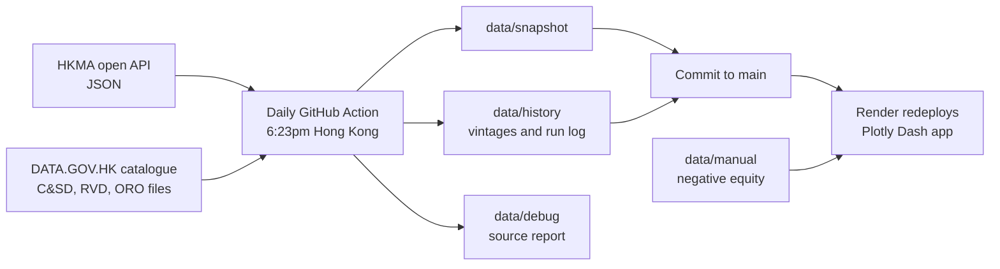

# Hong Kong Credit Risk Macro Dashboard

[](../../actions/workflows/ci.yml)
[](../../actions/workflows/refresh-data.yml)

A self-updating dashboard of the macroeconomic drivers of credit risk in Hong Kong. Every day it pulls official data from the Hong Kong Monetary Authority (HKMA), the Census and Statistics Department (C&SD), the Rating and Valuation Department (RVD), the Official Receiver's Office (ORO) and Hang Seng Indexes, keeps a point-in-time archive of every value and revision, and scores each driver on whether it is moving toward higher or lower credit risk.

The Hong Kong sister project of the [Australia Credit Risk Macro Dashboard](https://github.com/keithtang2025/au-credit-macro-dashboard).

## What it tracks

| Area | Indicator | Source | Frequency |
|---|---|---|---|
| Rates and liquidity | HKMA base rate; 1-month and 3-month HIBOR fixings | HKMA API | Daily / monthly |
| | Aggregate balance (interbank liquidity) | HKMA API | Daily |
| | USD/HKD within the 7.75 to 7.85 peg band | HKMA API | Monthly |
| Property and mortgages | Private domestic price index (all classes) and its year-on-year change | RVD via DATA.GOV.HK | Monthly |
| | Mortgage delinquency ratio (overdue 3 months or more) | HKMA API | Monthly |
| | Mortgages in negative equity, and their delinquency ratio | HKMA quarterly survey | Quarterly, manual |
| Yields and valuation | Residential rental yield (average of classes A to E, and Class A) and its gap to 1-month HIBOR | RVD via DATA.GOV.HK; HKMA | Monthly |
| | Hang Seng Index P/E ratio (history from 1973) and dividend yield | Hang Seng Indexes: P/E history file, then the monthly factsheet | Monthly |
| Banking asset quality | Classified loan ratio of retail banks | HKMA API | Quarterly |
| | Credit card charge-off ratio | HKMA API | Quarterly |
| | Loan growth; loan-to-deposit ratio | HKMA API | Monthly |
| Economy and corporate stress | Unemployment rate (seasonally adjusted) | C&SD via DATA.GOV.HK | Monthly |
| | Real GDP growth; composite CPI inflation | C&SD via DATA.GOV.HK | Quarterly / monthly |
| | Compulsory winding-up petitions and bankruptcy petitions, monthly and rolling 12 months | ORO via DATA.GOV.HK | Monthly |

Everything is automatic except negative equity, which HKMA publishes only as a quarterly press release.

## Credit risk scorecard

Each indicator's latest value is compared with the value about 12 months earlier (within 45 days), or with the previous value when the history is shorter. The signal is **Risk rising** when the move worsens borrower credit quality and **Risk easing** when it improves it:

- **Higher is worse:** base rate, HIBOR, unemployment, inflation, mortgage delinquency, classified loans, card charge-offs, winding-up and bankruptcy petitions, negative equity.
- **Lower is worse:** GDP growth, home prices, aggregate balance (a smaller balance means tighter interbank liquidity).
- **USD/HKD:** higher counts as worse, because a rate near the 7.85 weak-side limit signals capital outflow and tighter HKD liquidity.

## How the data pipeline works



1. **Daily refresh.** A scheduled GitHub Action (`.github/workflows/refresh-data.yml`) runs at 10:23 UTC (6:23pm Hong Kong), after the HKMA, C&SD and ORO afternoon releases. It can also be run by hand from **Actions > Refresh data snapshot > Run workflow**.
2. **HKMA** series come from the HKMA's documented open API, paged 1,000 rows at a time. Daily series are reduced to month-end values.
3. **C&SD, RVD and ORO** files are found through DATA.GOV.HK's catalogue API (`package_show`), which lists each dataset's current download links, so a new file name or year does not break anything. Each table is then searched by its row and column labels rather than fixed cells. The parser copes with the layouts these agencies use: years in their own column, three-month moving periods such as "Jul - Sep", quarters written as "2026Q2" or "Q2 2026", and one file per year (ORO).
4. **Fallbacks.** Each source and each HKMA endpoint fails independently: the others still update, the dashboard keeps the last saved copy, and the failure is logged. GitHub emails the repo owner if a whole run fails.
5. **Source report.** Every run writes `data/debug/source_report.md`, listing which file, table and label each series came from. If an agency changes a layout, the report prints the new table structure so the label pattern can be adjusted.

## Point-in-time data history

Official statistics get revised. To back-test a credit model without using information nobody had at the time, the pipeline keeps an append-only archive:

- `data/history/vintages.csv`: every value the first time it is seen (`new`), and again whenever the source revises it (`revised`), each stamped with its retrieval date. Nothing is ever deleted.
- `data/history/refresh_log.csv`: one row per series per run (`ok` or `failed`), an audit trail of the feed.

```python
from src.history import as_of, revisions

as_of("unemployment", "2026-12-31")   # the series exactly as it looked on that date
revisions("gdp_yoy")                  # every revision: old value, new value, date seen
```

## Project layout

```
app.py                       Dash app: KPI cards, scorecard, charts in five sections, data status panel
src/hkma.py                  HKMA open API client and series builders
src/govhk.py                 DATA.GOV.HK catalogue lookup and table readers for C&SD, RVD and ORO
src/market.py                Hang Seng Index dividend yield and P/E (performance feed, factsheet fallback)
src/periods.py               Parser for the period formats Hong Kong agencies use
src/xlsx_scan.py             Label-based series finder for spreadsheets
src/sources.py               Runs every source with independent failure handling
src/page.py                  Dashboard content (KPIs, chart sections) shared by the app and the static build
src/specs.py                 Series definitions and scorecard rules
src/data.py                  Loads the committed snapshot (1-hour cache)
src/scorecard.py             Risk signal logic
src/history.py               Point-in-time archive and as_of / revisions helpers
src/charts.py                Plotly figures
scripts/build_static.py      Builds the static GitHub Pages edition (site/index.html)
scripts/refresh_snapshot.py  Daily refresh entry point (run by GitHub Actions)
data/snapshot/               Latest copy of every series
data/history/                Append-only archive of values, revisions and runs
data/manual/                 Negative equity (quarterly, by hand); optional HSI yield history
data/debug/source_report.md  What the last refresh found, and where
tests/                       Unit tests (period parser, HKMA client, table readers, scorecard, app)
render.yaml                  Render blueprint
```

## Getting started

1. **Create your own copy.** Fork this repo, or push the files to a new GitHub repo.
2. **Allow the refresh to commit.** In GitHub, go to **Settings > Actions > General > Workflow permissions**, choose **Read and write permissions**, and save.
3. **Run the first refresh.** Go to **Actions > Refresh data snapshot > Run workflow**. The dashboard is empty until this has run once. When it finishes, check the log's last lines (for example `20 of 20 series refreshed`) and open `data/debug/source_report.md`.
4. **Deploy.** In Render, choose **New > Blueprint** and select the repo. Render reads `render.yaml` and starts the app with `gunicorn app:server`. Each daily data commit redeploys it. The free plan sleeps when idle, so the first visit after a quiet spell takes 30 to 60 seconds.

## Static edition (GitHub Pages)

A server-free copy of the dashboard is published to GitHub Pages after every daily refresh, so it never sleeps the way Render's free plan does. `scripts/build_static.py` renders the same KPIs, scorecard and charts (from `src/page.py`, shared with the Dash app) into a single `site/index.html`, and `.github/workflows/pages.yml` deploys it.

One-time setup: **Settings → Pages → Build and deployment → Source: GitHub Actions**. The page then lives at `https://<your-user>.github.io/<repo-name>/`. To build it locally: `python scripts/build_static.py` and open `site/index.html`.

## Run locally

```bash
python -m venv .venv && source .venv/bin/activate   # Windows: .venv\Scripts\activate
pip install -r requirements.txt
python scripts/refresh_snapshot.py   # fetch the data
python app.py                        # http://localhost:8050
pip install pytest && pytest -q      # tests
```

## Maintenance

**Negative equity (quarterly).** About a month after each quarter end, HKMA publishes "Residential mortgage loans in negative equity". Update the two rows in `data/manual/stress_indicators.csv`: the number of cases and the three-month delinquency ratio, with the year-earlier figures as `prior`. Edit on GitHub (pencil icon, then **Commit changes**); Render redeploys within minutes.

**If a series is missing.** The data status panel at the bottom of the dashboard shows each series' latest observation. Check `data/debug/source_report.md`: it names the file it tried and, for a failure, prints that table's layout. Label patterns are in `src/govhk.py` (`CSD_SPECS`, `fetch_rvd`, `fetch_oro`) and HKMA field names in `src/hkma.py`.

**Scheduled runs.** GitHub pauses scheduled workflows in repos with no activity for 60 days. The daily data commits normally count as activity, but if the workflow ever shows as disabled, re-enable it on the Actions tab.

## Limitations

- The scorecard is a directional monitor, not a forecasting model: each signal compares two points in time and signals are not weighted.
- HKMA asset-quality ratios (classified loans, card charge-offs) are quarterly and published with a lag.
- Unemployment is a three-month moving average, dated by the last month of the period.
- Hang Seng Indexes publishes only the latest dividend yield and P/E, so that history starts on the first refresh and grows by one point a month. Earlier months can be added to `data/manual/hsi_valuation.csv` (columns `date,dividend_yield,pe_ratio,source`).
- RVD publishes rental yields by flat size class only, so the "all classes" figure is a simple average of classes A to E, not a weighted one.
- Negative equity figures are entered by hand and are only as current as the last edit.

## Data sources

Hong Kong Monetary Authority open API; Census and Statistics Department, Rating and Valuation Department and Official Receiver's Office datasets on DATA.GOV.HK; Hang Seng Indexes Company (index dividend yield and P/E). Data remain subject to each provider's terms of use.

Built by Keith Tang, CFA. For research and education; not investment advice.
